#  Note-It

A cross-platform note-taking app for mobile and desktop, built from the ground up to prioritize data ownership and peace of mind.

I built Note-It because I was tired of bloated, insecure alternatives. It lets you work seamlessly across devices with flexible sync options ranging from local storage and zero-cloud Wi-Fi syncing to full cloud backups. Paired with military-grade encryption for sensitive data, Note-It ensures your notes stay completely under your control.
<!-- Tech Stack & Networking -->

| Desktop | Mobile |
| :---: | :---: |
| 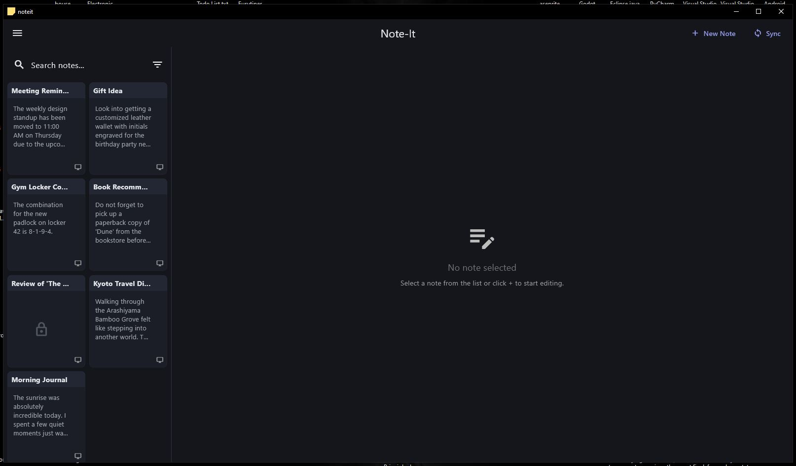 | 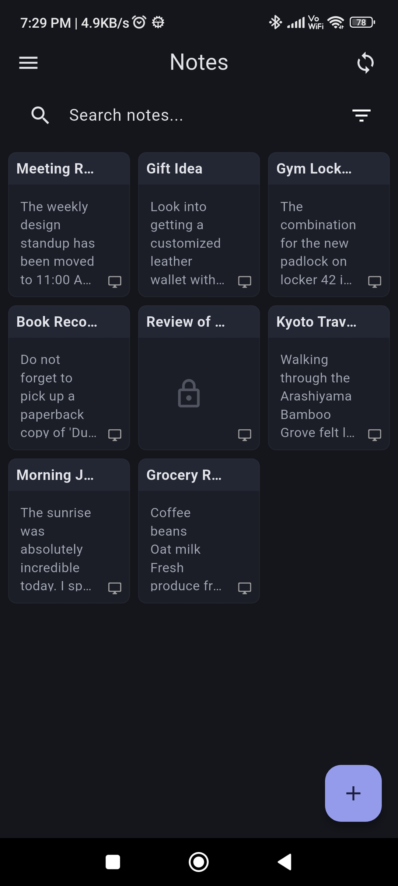 |

I chose a simple design approach that encapsulates the app's complex capabilities, allowing users to ease into the experience without feeling overwhelmed.

---

|                                Desktop                                 |                                   Mobile                                    |
|:----------------------------------------------------------------------:|:---------------------------------------------------------------------------:|
| 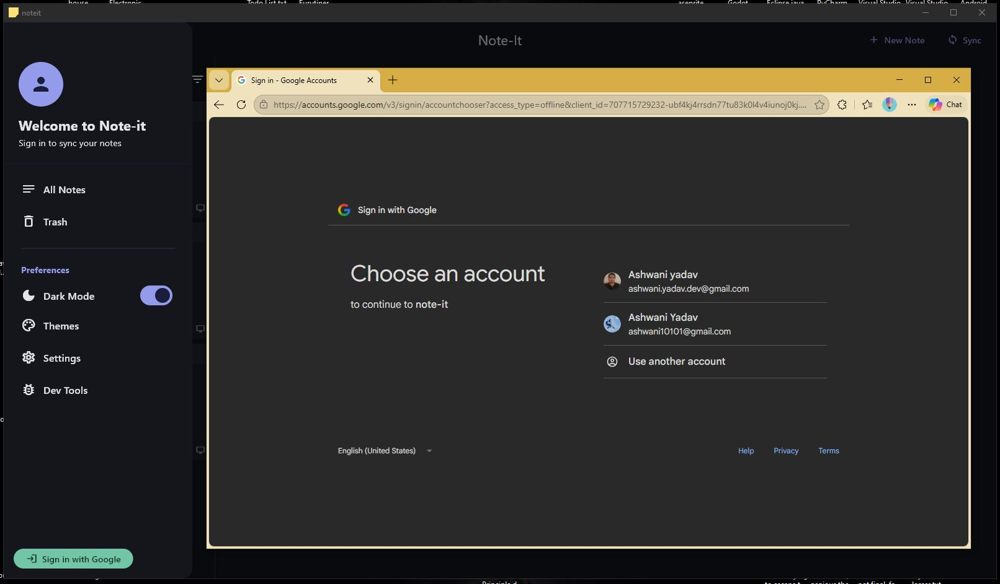 | 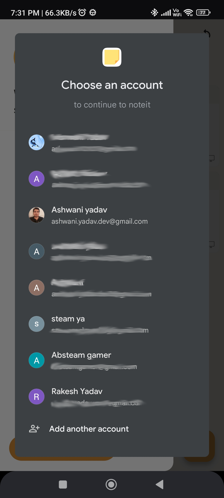 |

Supports Google authentication for Firebase synchronization. The benefit of syncing notes to the cloud is that you can access them from any device, anywhere in the world.

---

|                                   Desktop                                    |                                 Mobile                                 |
|:----------------------------------------------------------------------------:|:----------------------------------------------------------------------:|
| 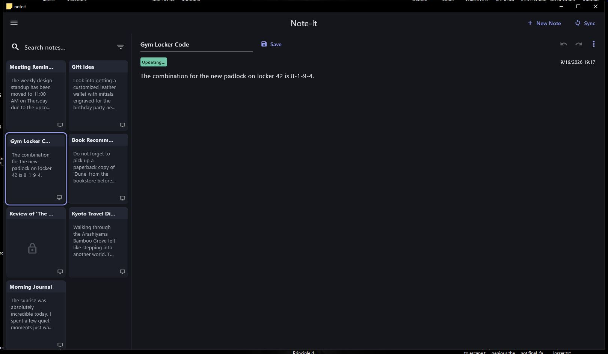 | 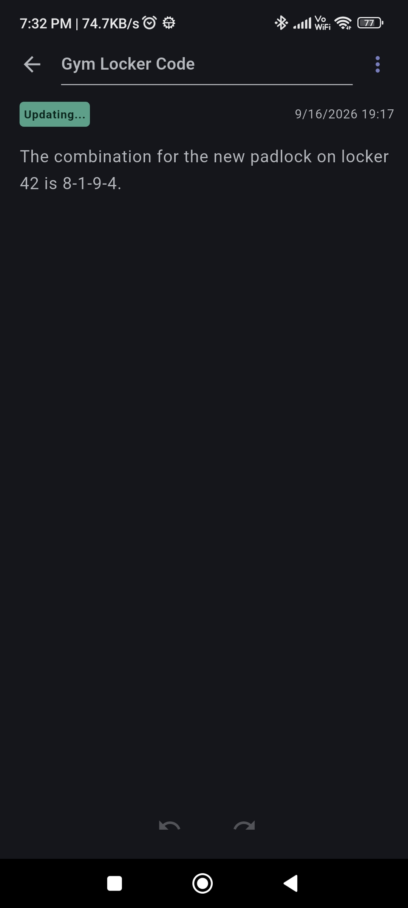 |

A simple note editor. The design is not finalized yet.

---

|                                Desktop                                |                                   Mobile                                   |
|:---------------------------------------------------------------------:|:--------------------------------------------------------------------------:|
| 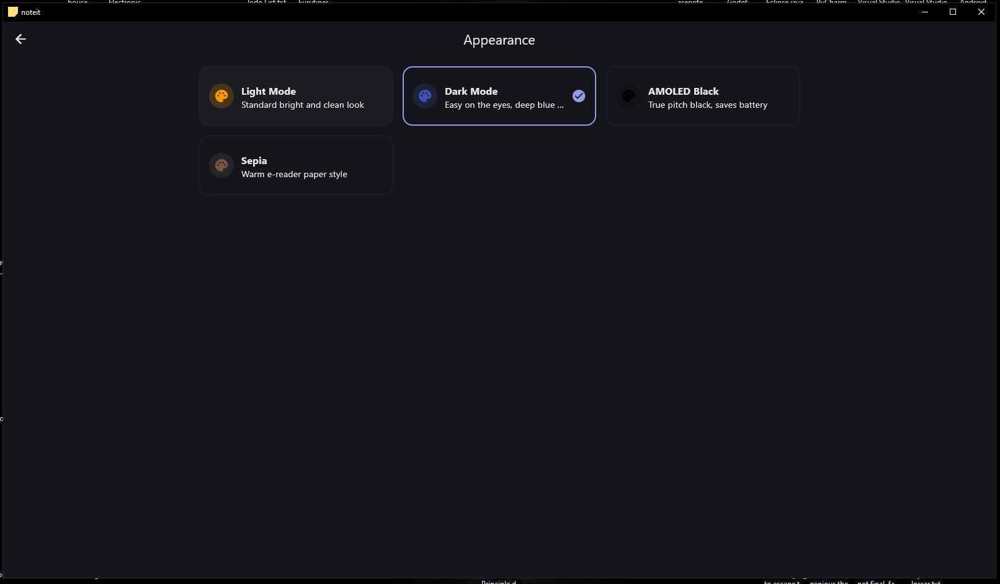 | 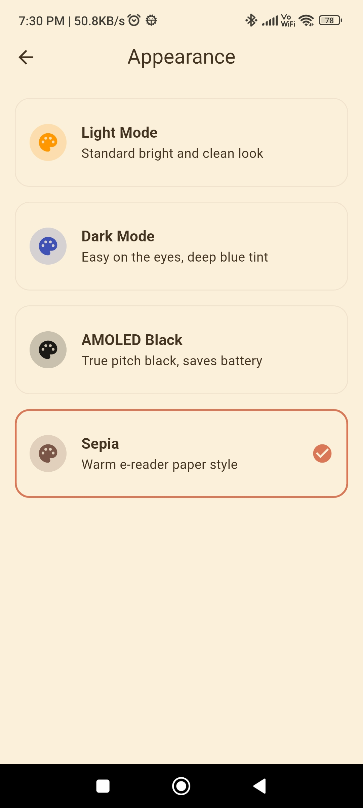 |

The themes page allows users to choose from a variety of themes. We currently support 4 themes, with plans to add 6 more before publishing the app to the Play Store.

---

|                                 Desktop                                 |                                 Mobile                                  |
|:-----------------------------------------------------------------------:|:-----------------------------------------------------------------------:|
| 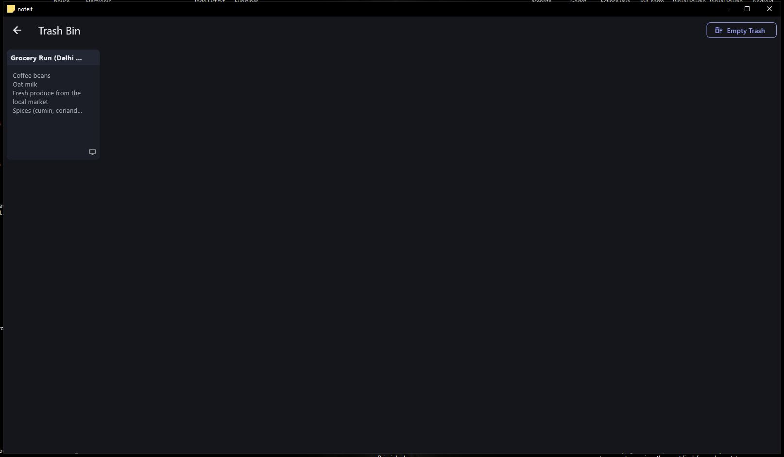 | 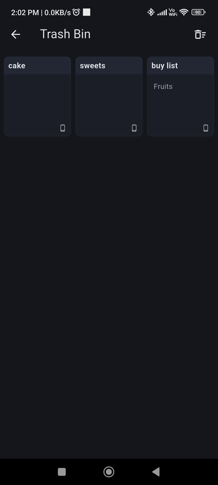 |

Added a trash bin to recover accidentally deleted notes, which can be configured to auto-clean after a month or a year.

---

|                                Desktop                                 |                                  Mobile                                  |
|:----------------------------------------------------------------------:|:------------------------------------------------------------------------:|
| 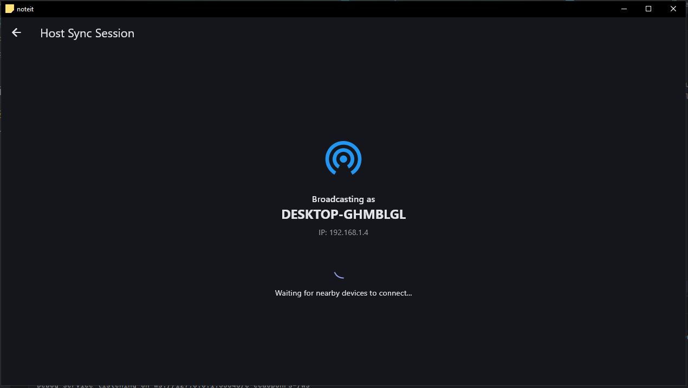 | 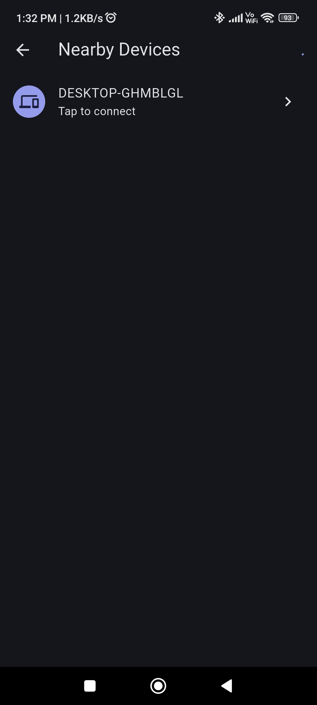 |

Hosting and connecting: uses mDNS for broadcasting device names over a custom TCP tag. Other devices can discover it, enter the correct PIN, and connect. *(Note: This screenshot is old; there is supposed to be a PIN display in the middle).*

### Some Other Screenshots

|                         Custom Highlighting                          |                                Filters                                |                                Password Lock                                 |
|:--------------------------------------------------------------------:|:---------------------------------------------------------------------:|:----------------------------------------------------------------------------:|
| 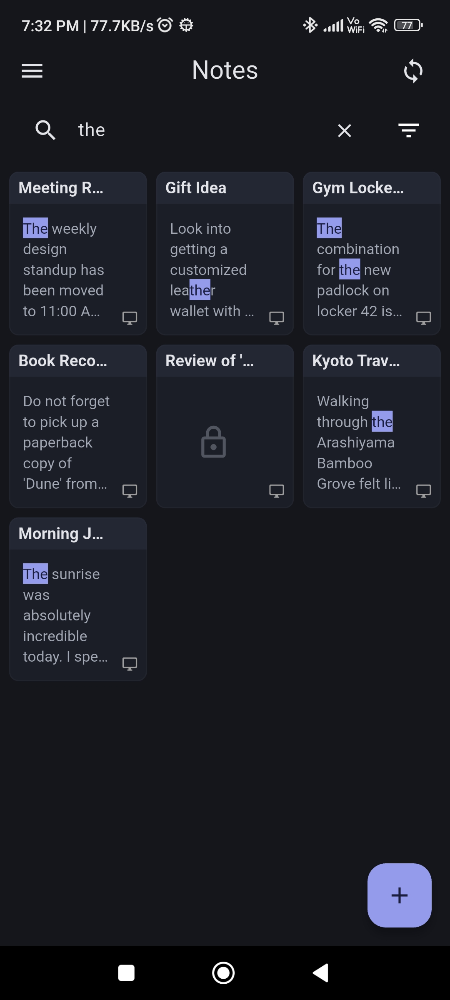 | 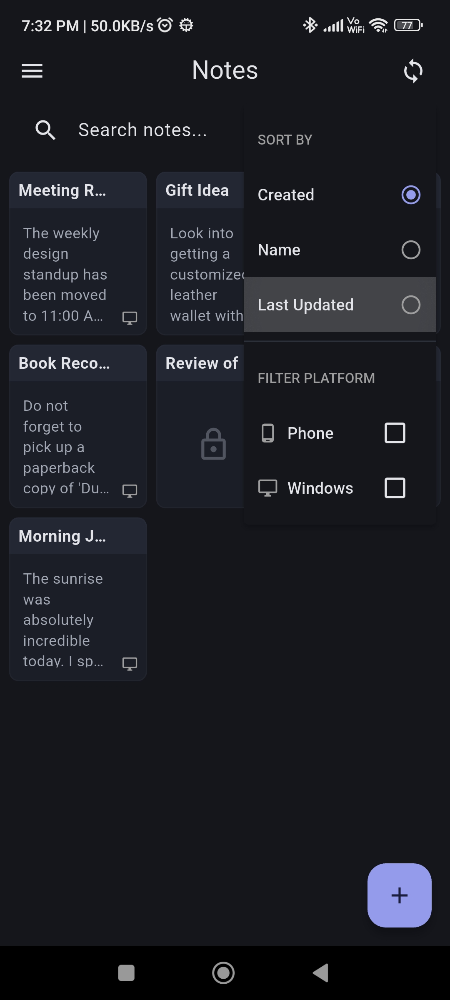 | 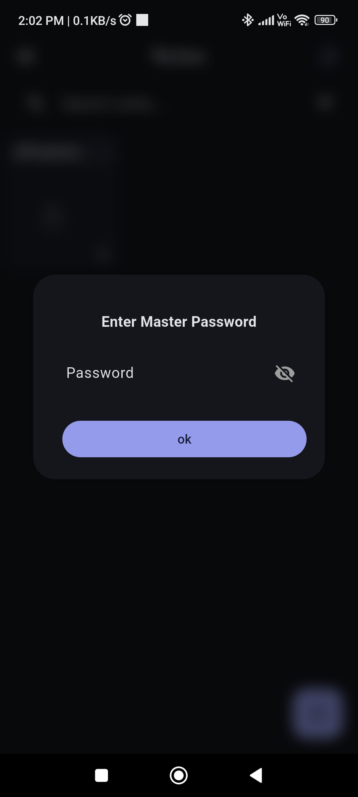 |

## ✨ Features

**Dual-Sync Architecture**
- ✅ **Cloud Sync:** Standard real-time sync using Firebase.
- ✅ **Local Wi-Fi Sync:** Peer-to-peer syncing without an internet connection. Uses mDNS for device discovery and WebSockets for data transfer. Includes dedicated Host/Client roles for stable pairing.
- ✅ **Manual Controls:** Pull-to-sync gesture (Android), dedicated sync buttons, and a control panel to toggle between Cloud, Wi-Fi, and Offline modes.

**Note Management**
- ✅ **Smart Search:** Queries titles and content with real-time text highlighting for matched queries.
- ✅ **Advanced Sorting & Filtering:** Sort by creation date, last updated, or name. Filter notes by device origin (e.g., created on Windows vs. Android).
- ✅ **Editor:** Clean interface with undo/redo functionality and automated datetime stamping.
- ✅ **Data Recovery:** Dedicated recycle bin to restore deleted notes.

**Security & Customization**
- ✅ **App-Level Locking:** Password protect specific notes via the control panel.
- ✅ **Data Export:** Import/Export functionality to ensure data portability.
- ✅ **Theming:** Quick dark mode toggle and 4 distinct theme palettes (including a custom amber theme).
- 🔒 **Authentication:** Google Sign-in integration for quick onboarding.

## 🏗️ Technical Implementation

### 💻 Tech Stack
- **Framework:** [Flutter](https://flutter.dev/) (SDK ^3.10.7)
- **State Management:** `flutter_riverpod` & `riverpod_annotation`
- **Local Database:** `drift` & `drift_flutter` (SQLite)
- **Backend/Auth:** `firebase_core`, `cloud_firestore`, `firebase_auth`, `google_sign_in_all_platforms`
- **P2P Networking:** `web_socket_channel`, `nsd` (Network Service Discovery)
- **Routing:** `go_router`

### 🧠 Architectural Decisions

* **Handling Three-Way State:** Coordinating data between a local SQLite database, Firebase streams, and WebSocket channels required strict state management. I used Riverpod to isolate these data sources, ensuring the UI always reflects a single source of truth regardless of the active sync method.
* **Zero-Cloud Local Sync:** To make the app truly offline-first, I implemented mDNS (Multicast DNS) using the `nsd` package. This allows Windows and Android devices on the same local subnet to automatically discover each other without manual IP entry, establishing a WebSocket connection for zero-latency local data transfer.
* **Complex Querying:** Instead of using a simple key-value store, I chose Drift (SQLite) for local persistence. The relational database structure allows for efficient execution of complex queries, such as the multi-parameter sorting (Name/Date) and device-origin filtering features.

## 🔒 Security Architecture

Note-It is engineered with a **Zero-Knowledge End-to-End Encryption (E2EE)** framework. Password-protected notes are encrypted locally before touching storage or network streams. The server or local sync peers never possess raw master passwords or unencrypted payload keys.

---

### 🛡️ Security Measures & Core Principles

1. **Zero-Knowledge Password Verification**: Raw master passwords are **never** stored on disk. `SharedPreferences` retains only a boolean `hasMasterPassword` flag. Password verification uses encrypted canary payloads (validation markers) that prove password correctness without saving hashes or plaintext strings.
2. **Hardware-Backed Secure Storage**: Cryptographic salt, local validation markers, hardware keys, and key-wrapping payloads are stored in platform hardware keystores via `FlutterSecureStorage` (Android Keystore, iOS Keychain, and Windows DPAPI/Credential Guard).
3. **Authenticated AES-256-GCM Encryption**: Note contents are encrypted using AES-256-GCM with unique 12-byte initialization vectors (IVs) and 16-byte MAC authentication tags.
4. **PBKDF2 Key Derivation**: Master keys are derived using PBKDF2 with SHA-256 and **600,000 iterations**, providing high resistance against offline GPU/dictionary attacks.
5. **Secure Memory Hygiene & Auto-Purging**: When the application is paused or backgrounded (`AppLifecycleState.paused` / `hidden`), `masterKeyBytes` in memory is zeroed out byte-by-byte (`_zeroOutMasterKeyMemory`), and active BIP39 seed phrases (`activeRecoveryPhrase`) are cleared.
6. **Key-Wrapping & Atomic Password Re-encryption**: Master keys are wrapped (encrypted) with BIP39 12-word seed recovery keys. When updating passwords or recovering via 12-word phrases, notes are re-encrypted atomically (`reencryptAllLockedNotes`) in SQLite transactions.
7. **P2P Wi-Fi Sync Mutual Handshake**: Over-the-air P2P WebSocket connections enforce a mutual `validation_handshake` using encrypted markers. Initial note payload broadcasts are gated (`_isPeerVerified`) until handshake verification succeeds, closing invalid connections immediately with code 4001.

---

### ⚙️ Key Cryptographic Functions

| Class / Module | Important Function | Description |
| :--- | :--- | :--- |
| `CryptoEngine` | `deriveMasterKey(password, salt)` | Derives a 256-bit AES master key using PBKDF2 (SHA-256, 600,000 iterations). |
| `CryptoEngine` | `encryptPayload(plainText, masterKey)` | Encrypts note content via AES-256-GCM, returning Base64-encoded `iv`, `ciphertext`, and `authTag`. |
| `CryptoEngine` | `decryptPayload(...)` | Decrypts AES-256-GCM ciphertext and validates MAC auth tag; throws `SecretBoxAuthenticationError` if key/data is invalid. |
| `CryptoEngine` | `createValidationMarker(...)` / `verifyValidationMarker(...)` | Generates and verifies zero-knowledge canary payloads for password authentication. |
| `CryptoEngine` | `wrapKey(...)` / `unwrapKey(...)` | Encrypts/decrypts master keys using recovery keys derived from BIP39 seed phrases. |
| `LockNotifier` | `setupMasterPassword(password)` | Generates salt, master key, recovery phrase, validation markers, and hardware storage keys. |
| `LockNotifier` | `recoverWithPhrase(words, newPassword)` | Restores access using a 12-word recovery phrase, unwraps the master key, and re-encrypts all locked notes. |
| `LockNotifier` | `_zeroOutMasterKeyMemory()` | Clears `masterKeyBytes` byte-by-byte and resets state when backgrounded. |
| `NotesDao` | `lockNote(...)` | Encrypts content and clears plain text `content` column in SQLite, storing structured JSON payloads. |
| `NotesDao` | `reencryptAllLockedNotes(...)` | Offloads batch note decryption & re-encryption to `ReencryptionIsolateWorker` and writes SQLite updates. |
| `ReencryptionIsolateWorker` | `batchReencrypt(...)` | Executes 100% of CPU-bound AES-256-GCM decryption & re-encryption off the main thread in a background Dart Isolate via `compute()`. |
| `LocalSyncNotifier` | `setActiveConnection(...)` / `_handleIncomingSyncPayload(...)` | Manages P2P socket lifecycle, transmits outbound validation handshakes, and gates note payloads until peer verification. |

---

### 🔄 Data Flow Pipelines

#### 1. Password Setup & Master Key Creation
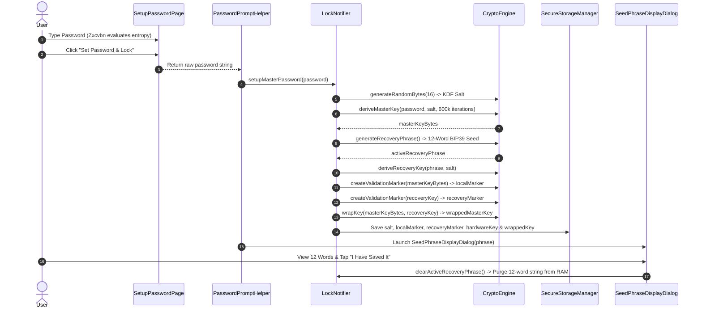

#### 2. Locking & Encrypting a Note
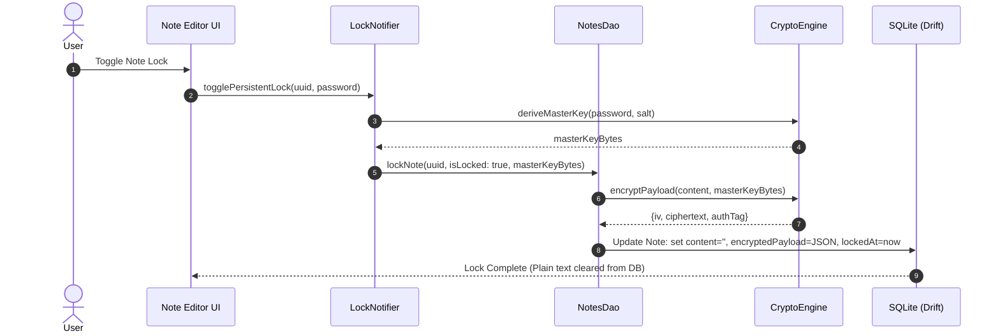

#### 3. Unlocking & Decrypting a Note
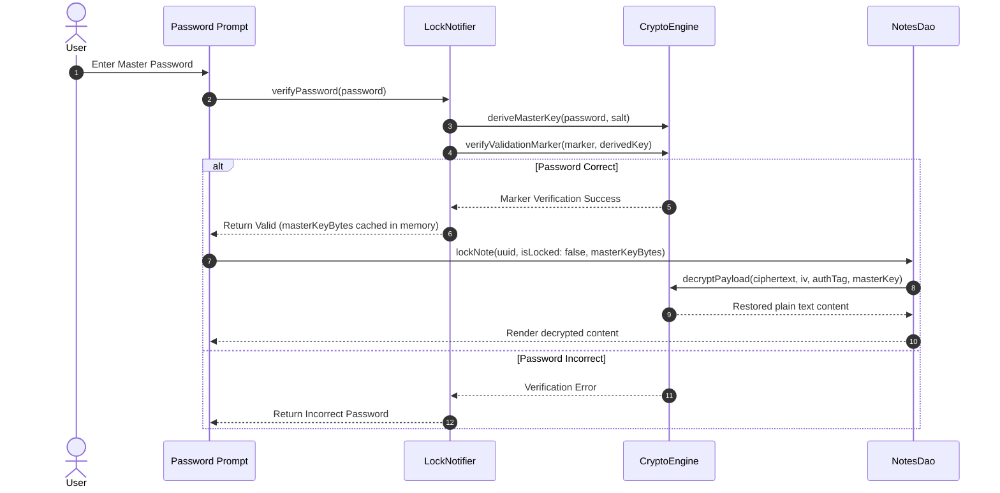

#### 4. Password Recovery & Atomic Re-encryption (Background Isolate Pipeline)
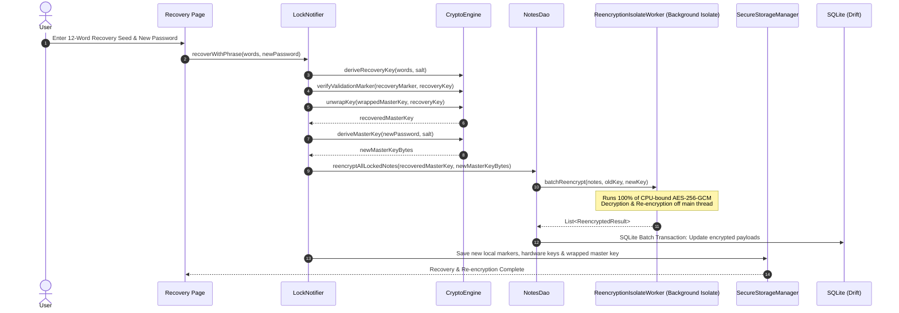

#### 5. P2P Wi-Fi Sync Handshake Gating
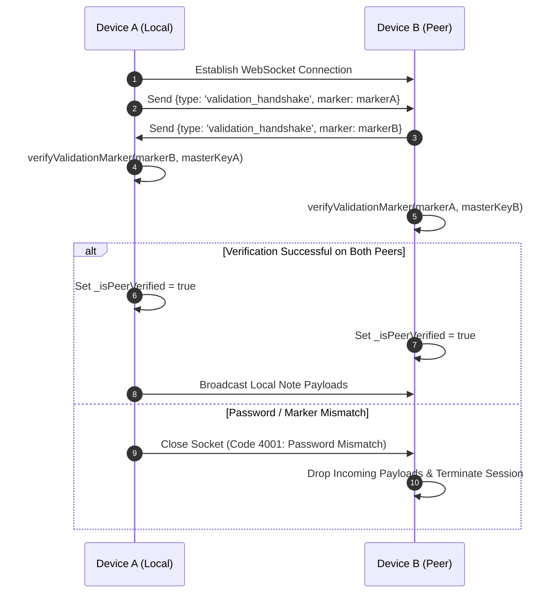

---

### 💡 Developer Perspectives & Challenges Faced

* **PBKDF2 Computational Cost vs UI Performance**: Deriving master keys using 600,000 PBKDF2 iterations takes ~0.5 seconds on mobile devices. While essential to block GPU-accelerated dictionary attacks, re-running KDF on every single note tap caused noticeable UI stutters. To solve this, I implemented an in-memory session key cache (`masterKeyBytes`) combined with fast-path session unlocks (`sessionUnlockWithActiveKey`), restricting expensive KDF iterations strictly to initial password entry or setup.
* **Dart Memory Management & Zeroing**: Dart garbage collection does not guarantee immediate zeroing of sensitive buffers. Furthermore, views extracted from key objects can return unmodifiable lists. Calling `.fillRange()` on unmodifiable views threw runtime `UnsupportedError` exceptions when backgrounding the app. I resolved this by copying derived key bytes into explicit mutable `Uint8List` buffers, zeroing them element-by-element during lifecycle transitions, and updating `LockState.copyWith` with explicit null-clearing flags (`clearMasterKey: true`).
* **Atomic Recovery Without Data Loss**: A major challenge during password recovery or password updates was preventing "orphaned" encrypted notes. If a password is updated without re-encrypting existing locked notes, old notes become permanently unreadable. I solved this by implementing `reencryptAllLockedNotes` inside an atomic SQLite transaction. If any single note fails to decrypt or re-encrypt, the transaction throws a `StateError` and rolls back entirely before secure storage keys are modified.
* **P2P Handshake Race Conditions**: In early Wi-Fi sync implementations, devices fired initial note sync broadcasts immediately upon socket connection. If Device A transmitted note payloads before Device B processed Device A's validation handshake, Device B dropped the payloads due to unverified state gates. I resolved this by deferring `broadcastLocalChanges()` until the mutual `validation_handshake` exchanges complete successfully.

## 📦 Dependencies

**Core & State Management**
- [Flutter](https://flutter.dev/) (SDK ^3.10.7)
- `flutter_riverpod` & `riverpod_annotation` - For predictable, compile-safe state management.

**Storage & Database**
- `drift` & `drift_flutter` - Reactive, type-safe persistence for local SQLite databases.
- `shared_preferences` - For lightweight local data and theme settings caching.
- `path_provider` - For locating local file system paths.

**Backend & Authentication**
- `firebase_core`, `cloud_firestore`, `firebase_auth` - Cloud data synchronization and backend infrastructure.
- `google_sign_in_all_platforms` - Seamless OAuth integration.

**Navigation**
- `go_router` - Declarative routing and deep linking.

**Hardware & Connectivity**
- `mobile_scanner` & `qr_flutter` - For scanning and generating QR codes.
- `web_socket_channel` & `nsd` - For real-time network service discovery and WebSocket communications.
- `device_info_plus` - For fetching specific device metadata.

**Dev Dependencies**
- `build_runner` & `drift_dev` - Code generation.
- `flutter_launcher_icons` - Automated app icon generation.

# License

This software is free for personal use and modification, but commercial use and selling for profit are strictly prohibited. Thank you